# SHADOWGRAPH 7.0.15

<p align="center">
  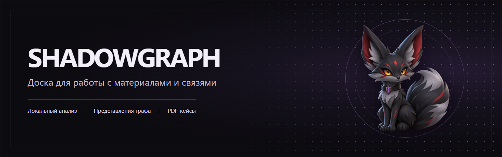
</p>

<p align="center">
  <strong>Рабочее пространство для исследования материалов и визуального анализа связей.</strong><br>
  Импортируйте источники. Проверяйте находки. Собирайте картину в одном проекте.
</p>

<p align="center">
  <code>GitHub Pages</code> · <code>Локальный анализ</code> · <code>11 видов графа</code> · <code>ПК и телефон</code>
</p>

<p align="center">
  <a href="#возможности">Возможности</a> ·
  <a href="#интерфейс">Скриншоты</a> ·
  <a href="#быстрый-старт">Быстрый старт</a> ·
  <a href="#публикация-на-github-pages">Размещение</a> ·
  <a href="#данные-и-приватность">Приватность</a>
</p>

---

## От материалов к связям

SHADOWGRAPH помогает разбирать документы и заметки, выделять объекты и видеть, как они связаны. У находок сохраняются фрагменты источников и объяснения: к каждой записи можно вернуться и проверить контекст.

Приложение работает в браузере. Для этой сборки не нужен отдельный сервер анализа или облачная база проектов.

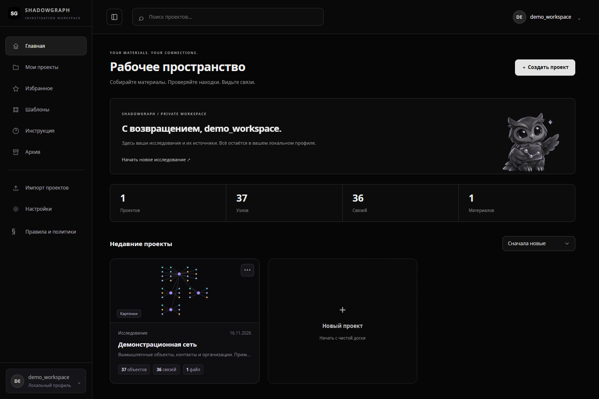

## Возможности

| Инструмент | Что можно сделать |
| :--- | :--- |
| **Автоанализ** | Выделять контакты, людей, организации, адреса, реквизиты и другие объекты; распознавать подписанные поля на русском и английском. |
| **Материалы и OCR** | Извлекать текст из PDF, распознавать сканы и изображения, просматривать метаданные фотографий. |
| **Источники и проверка** | Читать исходные фрагменты, смотреть основания связей, назначать статусы проверки. |
| **Граф** | Переключать карточки, круги, объёмную сеть и вид «Мальтего»; менять расстановку, подписи и цвета. |
| **Ручная работа** | Создавать и редактировать объекты, соединять узлы, закреплять позиции, искать путь и проверять дубликаты. |
| **Карта** | Добавлять точки по координатам, включать подложку 2D/3D и сохранять её снимок в проекте. |
| **Экспорт** | Сохранять JSON проекта, снимки PNG, SVG и PDF-досье с реестрами и внутренними переходами. |
| **Личное пространство** | Организовывать проекты, избранное и архив; настраивать профиль, аватар и автоблокировку. |

Автоматическая находка — повод проверить источник. Совпадение имени, контакта или адреса само по себе не подтверждает личность и владение.

## Интерфейс

### Четыре взгляда на один проект

Данные проекта общие, а расстановка и камера представлений сохраняются отдельно. Выбирайте вид под задачу.

| **Карточки** | **Мальтего** |
| :---: | :---: |
| <a href="docs/images/graph-cards.png"></a> | <a href="docs/images/graph-maltego.png">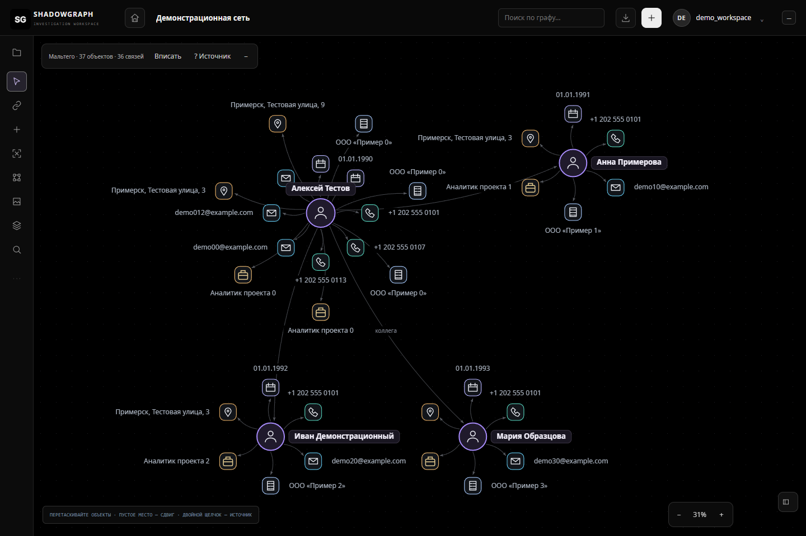</a> |
| Подробные записи, свойства и маршруты линий. | Компактные пиктограммы, стрелки и подписи. |
| **Круги · 2D** | **Сеть · 3D** |
| <a href="docs/images/graph-circles.png">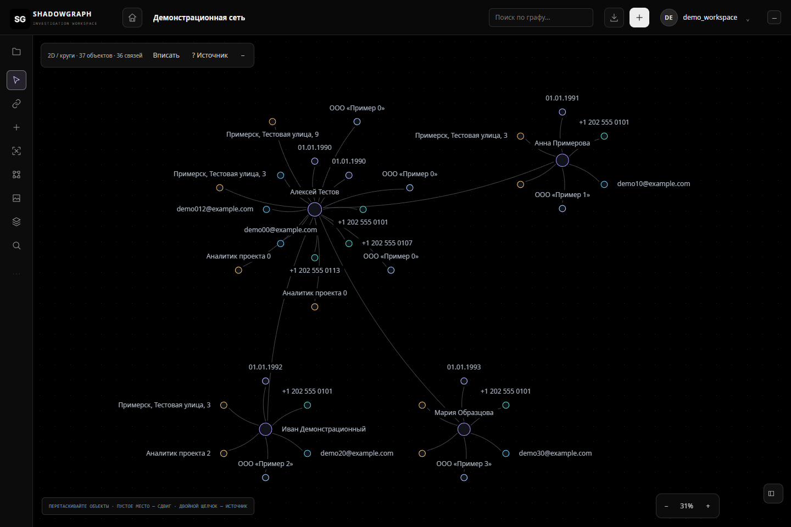</a> | <a href="docs/images/graph-3d.png">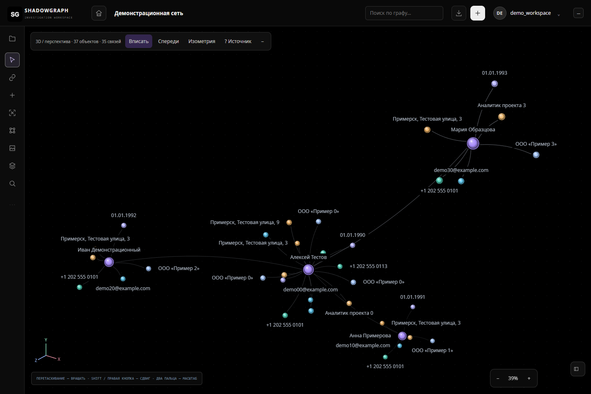</a> |
| Плоский обзор групп и взаимосвязей. | Глубина, перспектива, вращение и изометрия. |

<sub>На скриншотах — вымышленные учебные записи. Изображения можно открыть в полном размере. «Мальтего» — название визуального режима SHADOWGRAPH, без интеграции с сервисами Maltego.</sub>

### Точки и объёмная карта

**Инструменты → Карта**: укажите название, широту и долготу. Подложка подключается отдельной кнопкой; можно переключить 2D/3D, переместить точку и сохранить снимок на доске.

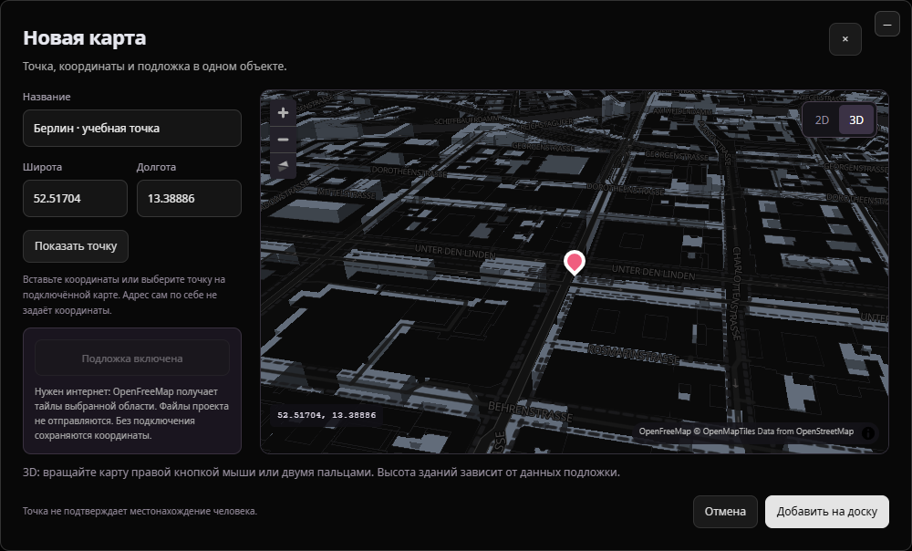

Для онлайн-подложки нужен интернет. Наличие и высота 3D-зданий зависят от данных карты. Без подключения можно сохранить координаты; ранее сохранённый снимок остаётся внутри проекта.

### На телефоне

<p align="center">
  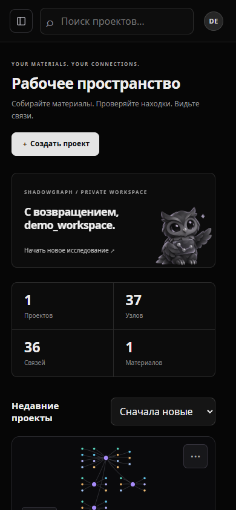
</p>

- Адаптивные окна, сворачиваемые панели и боковое меню.
- Перемещение графа пальцем и масштабирование двумя пальцами.
- Создание проектов, импорт, редактирование карточек и профиль с телефона.
- Смотритель встречает на главной и пустой доске. Анимацию можно отключить в настройках.

### PDF, который удобно читать

Отчёт включает обложку с графом, обзор, карту, источники, находки и основания связей. Оглавление и закладки помогают перемещаться по документу; ссылки из связей ведут к карточкам объектов.

<p align="center">
  <a href="docs/examples/sample-report.pdf">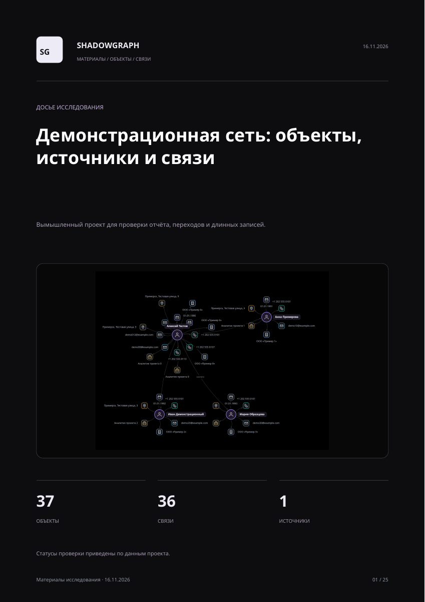</a>
  &nbsp;
  <a href="docs/examples/sample-report.pdf">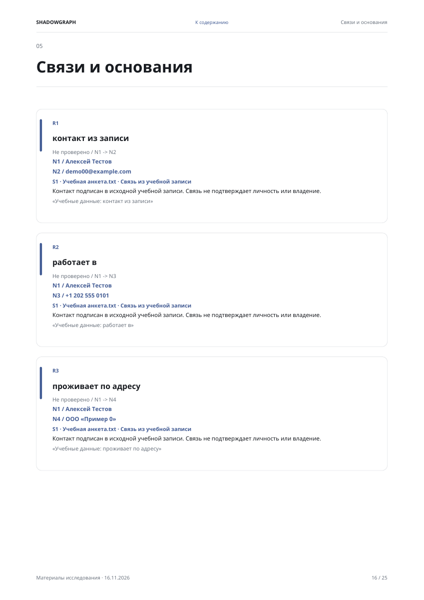</a>
</p>

<p align="center">
  <a href="docs/examples/sample-report.pdf"><strong>Открыть пример PDF-досье →</strong></a>
</p>

## Быстрый старт

1. Откройте опубликованный сайт и создайте локальный профиль.
2. Сохраните выданный ключ доступа: он нужен для повторного входа.
3. Нажмите **«Создать проект»** и задайте название.
4. Выберите **«Добавить материалы»**, загрузите файл и оставьте включённым анализ.
5. Проверьте находки через инспектор и сведения об источнике. При необходимости отредактируйте записи и связи.
6. Выберите представление графа, выполните авторасстановку и сохраните результат через **«Экспорт»**.

### Попробовать на учебных данных

| Материал | Как использовать |
| :--- | :--- |
| [Готовый демонстрационный проект · JSON](docs/examples/demo-project.json) | Скачайте файл и выберите **«Импорт проектов»** на главной. Внутри 37 объектов и 36 учебных связей. |
| [Учебные заметки · TXT](docs/examples/demo-notes.txt) | Загрузите как новый материал с включённым анализом и посмотрите, какие записи найдут правила. Результат может отличаться от вручную подготовленного проекта. |
| [Пример PDF-досье](docs/examples/sample-report.pdf) | Посмотрите оформление, реестры и переходы по отчёту. |

Во всех учебных материалах используются вымышленные сведения.

### Видеоинструкции

[Смотреть инструкцию для ПК · MP4](public/guide67/desktop.mp4) · [Смотреть инструкцию для телефона · MP4](public/guide67/phone.mp4)

Эти же видео и пошаговые снимки доступны внутри приложения в разделе **«Инструкция»**.

## Публикация на GitHub Pages

Сборка уже содержит готовые статические файлы. Установка зависимостей и отдельная сборка не требуются.

1. Создайте репозиторий или откройте существующий.
2. Загрузите **содержимое сборки в корень репозитория**, сохранив `public/`, `docs/` и файл `.nojekyll`. Рядом должны находиться `index.html` и этот README.
3. В **Settings → Pages** выберите публикацию из ветки, нужную ветку и папку **`/ (root)`**.
4. Сохраните настройки и дождитесь публикации. Адрес появится в разделе Pages.

[Официальная инструкция GitHub Pages](https://docs.github.com/en/pages/getting-started-with-github-pages/creating-a-github-pages-site).

При обновлении сначала экспортируйте важные проекты. Для сохранения прежнего локального хранилища используйте тот же адрес сайта и браузер.

<details>
<summary><strong>Локальный просмотр без публикации</strong></summary>

Если установлен Python 3, откройте терминал в папке сборки и выполните:

```sh
python -m http.server 8080
```

Затем откройте **http://localhost:8080**. Для нормальной работы браузерных функций используйте HTTP/HTTPS, а не запуск `index.html` двойным щелчком.

</details>

## Данные и приватность

- **Анализ на устройстве.** Материалы обрабатываются в браузере и не отправляются на сервер анализа.
- **Локальные профили.** Проекты и настройки хранятся в этом браузере с шифрованием AES-GCM. Между устройствами нет автоматической синхронизации.
- **Онлайн-карта — по запросу.** При её включении OpenFreeMap получает запросы тайлов выбранной области и обычные сетевые данные соединения. Файлы проекта и ключ профиля не отправляются.
- **Статистика этого браузера.** Панель владельца показывает локальные события и активные вкладки, а не общее число посетителей сайта.
- **Резервные копии.** Очистка браузера может удалить локальные данные. JSON, PDF и изображения экспортируются обычными незашифрованными файлами: учитывайте их содержимое перед передачей.

<details>
<summary><strong>Ключ доступа и активный сеанс</strong></summary>

Сохраните личный ключ отдельно от репозитория. Ключи, личные выгрузки и материалы исследований не нужно загружать в GitHub вместе с сайтом.

Для восстановления входа активная вкладка может временно хранить производный ключ хранилища. На общем устройстве завершайте работу кнопкой **«Выйти»**. Восстановления потерянного ключа по почте в локальной версии нет.

Хостинг имеет собственные правила обработки сетевых данных. Приложение не гарантирует анонимность владельца репозитория или домена.

</details>

## Внутри репозитория

```text
.
├── index.html                 # Вход и рабочее пространство
├── public/                    # Локальные библиотеки, шрифты и ресурсы
│   ├── workspace.html         # Дополнительная точка входа
│   ├── brand/                 # Логотип и Смотритель
│   ├── guide67/               # Скриншоты и видеоинструкции
│   └── vendor/                # PDF, OCR, карта и другие библиотеки
├── docs/
│   ├── images/                # Изображения этого README
│   └── examples/              # Учебный проект, заметки и пример PDF
├── .nojekyll                  # Публикация статических ресурсов
├── CHANGELOG.md               # История основных изменений
└── README.md
```

## Поддержка

Вопросы и сообщения об ошибках:

- Telegram: [@auedurov](https://t.me/auedurov).
- Почта: [shadowgraphsupport@duck.com](mailto:shadowgraphsupport@duck.com).

Контакты также доступны на главной странице приложения и в меню профиля → «Поддержка».

## Ещё о проекте

- [Что изменилось в версиях](CHANGELOG.md).
- [Словарь подписей полей](СЛОВАРЬ_ПОДПИСЕЙ.md).
- Карта: [MapLibre GL JS](https://maplibre.org/maplibre-gl-js/docs/) и [OpenFreeMap](https://openfreemap.org/), данные © [OpenStreetMap](https://www.openstreetmap.org/copyright) и © [OpenMapTiles](https://openmaptiles.org/). [Лицензии компонента карты](public/vendor/map710/LICENSE.txt).

---

<p align="center">
  <strong>SHADOWGRAPH</strong><br>
  <sub>Ваши материалы. Ваши связи. Ваше рабочее пространство.</sub>
</p>


### Представления 7.0.3

Иерархия (два направления), хронология с периодом и областью без даты, сворачиваемые группы по типам, людям и организациям. Настройки каждого вида и камера сохраняются в проекте. В 3D есть инерция и переключаемое автовращение.

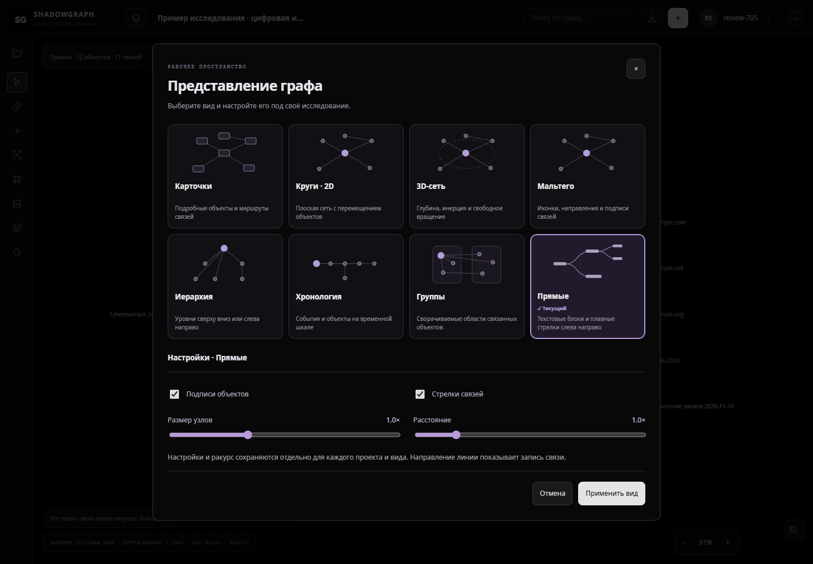

| Иерархия | Хронология |
|:--:|:--:|
| 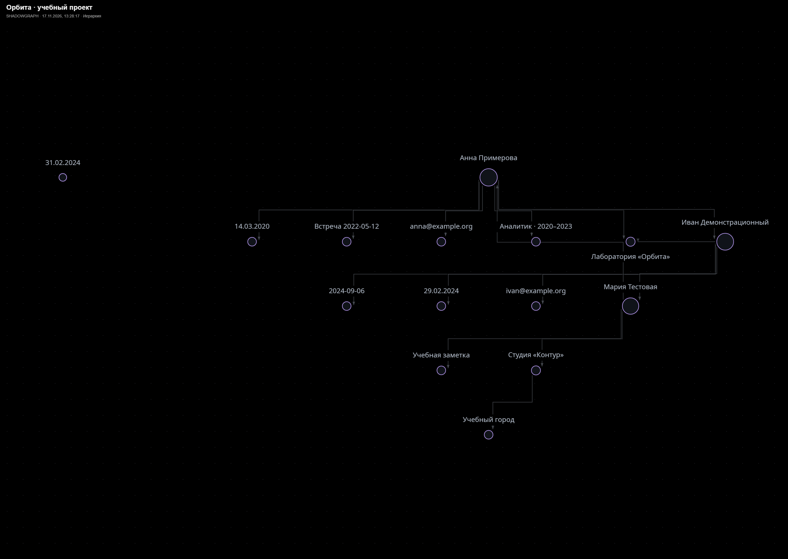 | 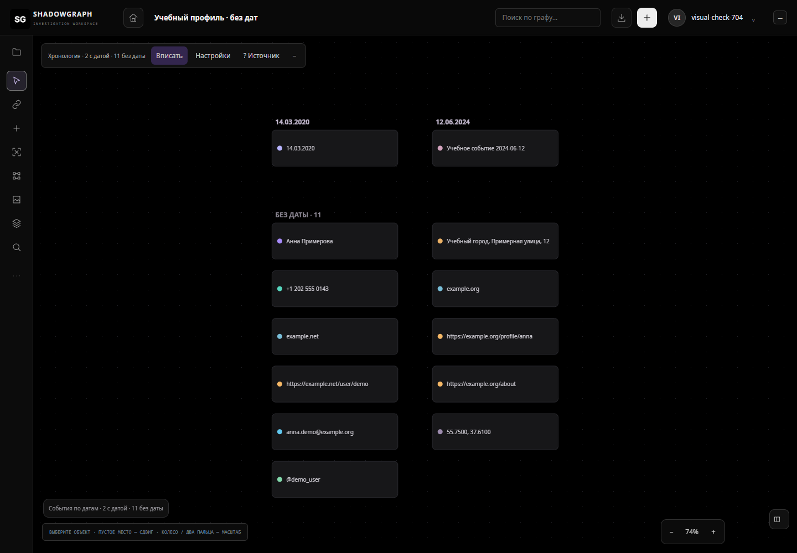 |

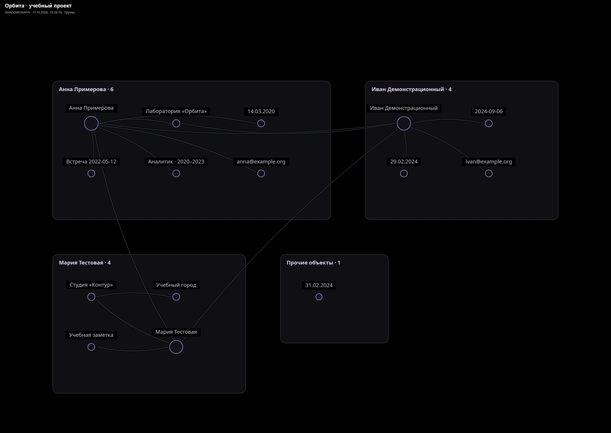


### Исправления 7.0.4

Компактные группы с объединёнными связями между областями, понятный экран хронологии без дат и чёрная строка кнопок настроек. Пустые области скрытых источников убраны. Исходные объекты и связи сохранены.


### Новое в 7.0.5

Представление «Прямые»: текстовые блоки с направленными разветвлениями слева направо. Тёмный календарь периода с выбором месяца, года, сегодняшней даты и очисткой. PDF: новая светлая обложка с картой, содержание, отдельный обзор со статистикой и обновлённые записи реестров.

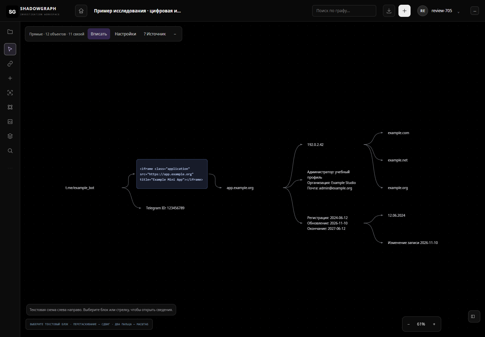

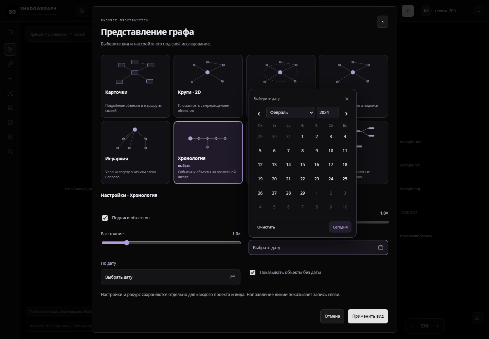

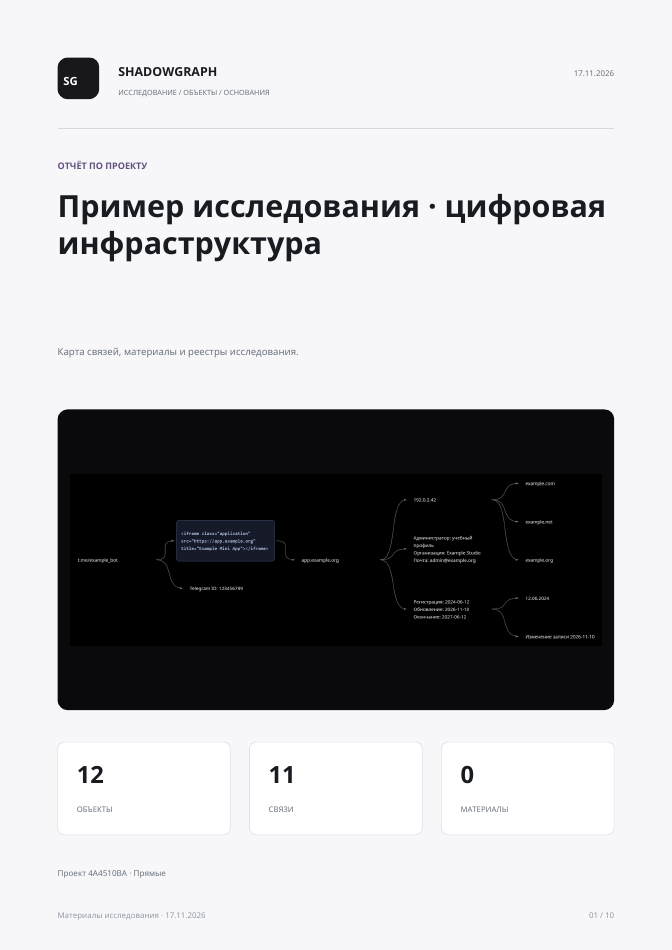


### PDF 7.0.6

Новая обложка, компактный паспорт с содержанием, пропорциональная карта и увеличенные фрагменты. Продолжения длинных записей сохраняют номер и название; ссылки ведут к материалам и объектам. Можно добавить собственный комментарий к отчёту.

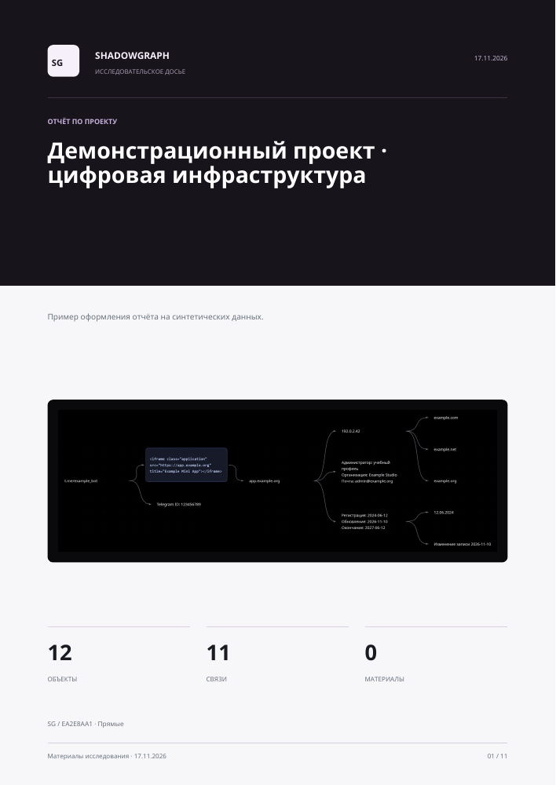

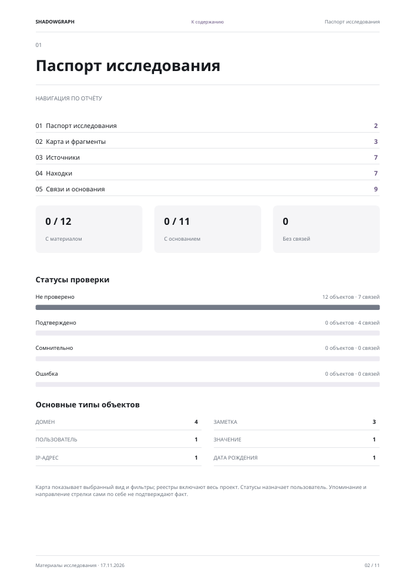


### Новое в 7.0.7

Переработаны «Прямые» и «Иерархия»: компактные блоки с переносом длинных строк, уровни от основного объекта, широкие уровни в нескольких рядах, скруглённые маршруты в обход блоков. Циклы и обратные связи сохраняются. Старые координаты этих двух видов автоматически пересчитываются один раз. Исправлен пересчёт при изменении размера узлов и текста заметки.


### Новое в 7.0.8

PDF-кейсы в главном меню: несколько зашифрованных черновиков, шаблон, выбор проекта и материалов, порядок разделов, автор, выводы, оформление и экспорт PDF. В 3D можно перемещать отдельный узел мышью или пальцем; пустое место вращает камеру.


### Новое в 7.0.9

Контекстное меню доски: правая кнопка, долгое нажатие или Shift+F10. Создание в точке нажатия, заметки, ссылки, материалы проекта, дублирование, связывание, ручные группы, сетка и блокировка перемещения. Семь новых инструментов: каталог, центральность, компоненты, изолированные объекты, аудит структуры, CSV и ручные группы. Три новых представления: орбиты, колонки и матрица направленных связей.


### Новое в 7.0.10

Обновлены «Колонки» и «Орбиты»: мягкие панели, иконки типов, счётчики объектов, перенос длинных названий, акцент на центре и связанных объектах. Плавные связи соединяются с границами элементов. Существующие данные и настройки других представлений сохраняются.


### Новое в 7.0.11

Сохранение входа на этом устройстве, зашифрованная сессия без привязки к версии сайта, повтор загрузки при временном сбое. Новые инструменты: очередь проверки, окружение и сравнение объектов. Меню панелей с режимом фокуса и быстрыми действиями. Раздел профиля «Вход и копии», автор новых PDF-кейсов и отметка резервной копии. Обновлены выбор представления, панели графа, подписи и материал 3D-сфер. Автоблокировка и ручной выход сохраняются. Для переноса на другой домен экспортируйте проекты: браузеры разделяют хранилища разных сайтов.


### Новое в 7.0.12

- В разделе правил доступен документ «Договор» (PDF).
- Авторасстановка карточек учитывает форму экрана и сохраняет закреплённые позиции.
- Новая объёмная расстановка и более читаемые линии: разделение параллельных связей, петли, подсветка выбора и глубина.


### Новое в 7.0.13

В «Орбитах» обновлены размещение групп и уровней, кольца с номерами, подписи и подсветка связей. Объект можно выбрать по подписи.


### Новое в 7.0.14

Обновлён стиль «Орбит»: уровни различаются цветом, центры выделены, подписи стали легче. Объекты внешних колец выстраиваются ближе к связанным с ними узлам предыдущего уровня.


### Новое в 7.0.15

В 3D-сети траектории связей построены в пространстве и вращаются вместе с объектами. Передние линии ярче дальних, наведение показывает подпись, а щелчок выбирает ближайшую линию.
