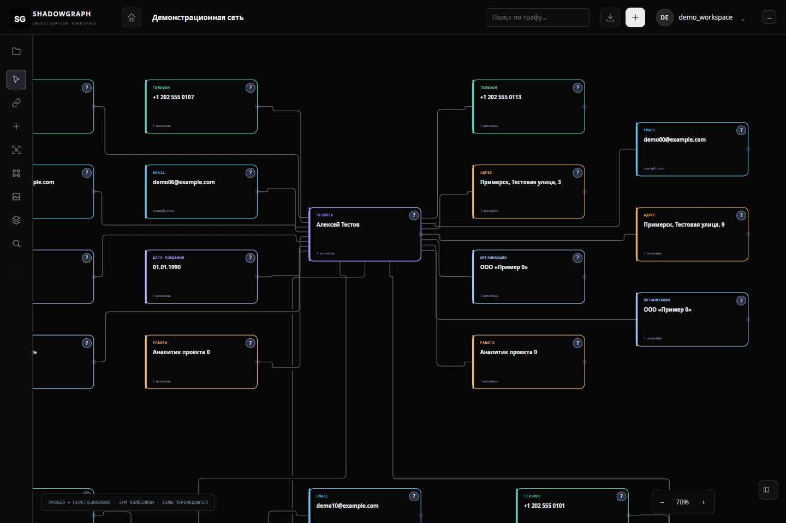

# SHADOWGRAPH

**Рабочая доска для исследований.** Собирайте материалы, разбирайте связи между объектами и оформляйте результаты в PDF. Анализ выполняется на вашем устройстве. Проекты хранятся в зашифрованном локальном профиле.

[Быстрый старт](#быстрый-старт) · [Большие графы](#большие-графы) · [FRAMEWORK](#framework) · [Партнёры](#партнёры) · [GitHub Pages](#github-pages)

## Версия 7.0.47

На главной переключайте счётчик между карточками, связями, файлами и пометками. Диаграмма рядом показывает типы карточек на активных досках. Пункт **Сводка досок** открывает список с количеством карточек и связей для каждого проекта.

При создании доски появляется обучение из пяти шагов. Нажмите **Показать** для начала или **Не сейчас**, чтобы сразу работать. Вернуться к подсказкам можно через **Инструменты → Обучение на доске**.

На стартовой мозг из частиц реагирует на курсор и меняет освещение при движении. В разделе **О проекте** можно открыть [пример PDF-отчёта](docs/examples/sample-report.pdf) и перейти к регистрации.

[История изменений](CHANGELOG.md).

## Быстрый старт

1. Создайте профиль и сохраните ключ. Для повторного входа используйте **Войти по ключу**.
2. Откройте **Создать проект**. Перетащите файлы на доску или нажмите **Добавить материалы**.
3. Проверьте найденные объекты и связи по исходным фрагментам в инспекторе.
4. Выберите вид графа. Через **Экспорт** сохраните резервную копию JSON, а через **PDF-кейсы** соберите отчёт.

| Материал | Как использовать |
| --- | --- |
| [Учебный проект · JSON](docs/examples/demo-project.json) | Откройте в **Импорт проектов** на главной. |
| [Учебные записи · TXT](docs/examples/demo-notes.txt) | Загрузите в проект с включённым анализом. |
| [Пример отчёта · PDF](docs/examples/sample-report.pdf) | Посмотрите, как в документе оформлены выводы и источники. |

Раздел **Инструкция** на главной и в инструментах доски содержит пошаговые подсказки по графу, отчётам, резервным копиям и FRAMEWORK. [Экран входа](docs/images/entry745.png).

## Большие графы

**Вписать граф** показывает общий план. На больших досках при сильном отдалении видна часть связей между ближайшими объектами. Нажмите **К связям**, чтобы приблизить выбранный объект или перейти к одному из наиболее связанных.

| Карточки | 3D-сеть |
| :---: | :---: |
|  |  |

- **Авторасстановка** группирует связанные карточки и сохраняет положение закреплённых объектов.
- **Инструменты** показывают закреплённые объекты, находки из нескольких материалов, файлы без находок и связи без пояснений.
- **Повторный анализ** сохраняет расстановку при выключенной галке и использует уже извлечённый текст PDF.
- **Ручка** и **Текст** добавляют разметку на доску.

У автоматического анализа есть лимит находок на файл. При достижении лимита приложение показывает предупреждение и сохраняет исходный материал.

## FRAMEWORK

Каталог из 887 ресурсов в 38 разделах. Вкладка **Справочники** содержит подборку по блокчейнам, морскому транспорту и авиации. Поиск работает по названию и домену. Перетаскивание, масштабирование, список и полноэкранный режим доступны из каталога.

[Отчёт по ссылкам · CSV](public/framework/link-audit.csv) · [Лицензия исходного OSINT Framework](public/framework/LICENSE.txt).

## Партнёры

В разделе **Партнёры** карточки RosGuardian открывают в новой вкладке страницы материалов с оглавлением, источником и переходом обратно к каталогу партнёров.

[Скриншот статьи](docs/images/partners737.png) · [Материал о сиренах в Калининграде](public/partners/kaliningrad.html) · [Обзор обсуждения в Telegram](public/partners/telegram.html).

## GitHub Pages

1. Загрузите содержимое сборки в корень репозитория. Сохраните `index.html`, папки `public/` и `docs/` вместе с `.nojekyll`.
2. В **Settings → Pages** выберите **Deploy from a branch**, нужную ветку и папку **/ (root)**.
3. Дождитесь публикации и откройте адрес из раздела Pages. [Документация GitHub Pages](https://docs.github.com/en/pages/quickstart).

Для локального просмотра запустите `python -m http.server 8080` в папке сборки и откройте [localhost:8080](http://localhost:8080).

### Объявления

В панели владельца составьте объявление и скачайте `announcements.json`. Опубликуйте файл как `public/announcements.json`. После публикации он появится в колокольчике у пользователей.

### Данные профиля

Сохраните ключ и резервные копии отдельно. Зашифрованный профиль привязан к браузеру и адресу сайта. Для переноса экспортируйте проекты в JSON. Учтите, что JSON и PDF могут содержать сведения из проекта.

[Словарь подписей полей](field-labels.md).

## Поддержка

[Telegram @auedurov](https://t.me/auedurov) · [shadowgraphsupport@duck.com](mailto:shadowgraphsupport@duck.com)
