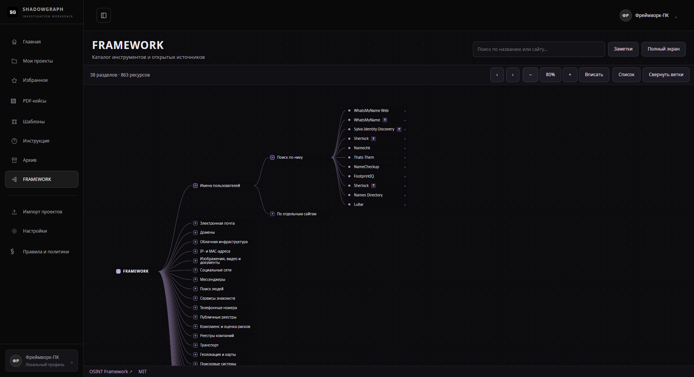
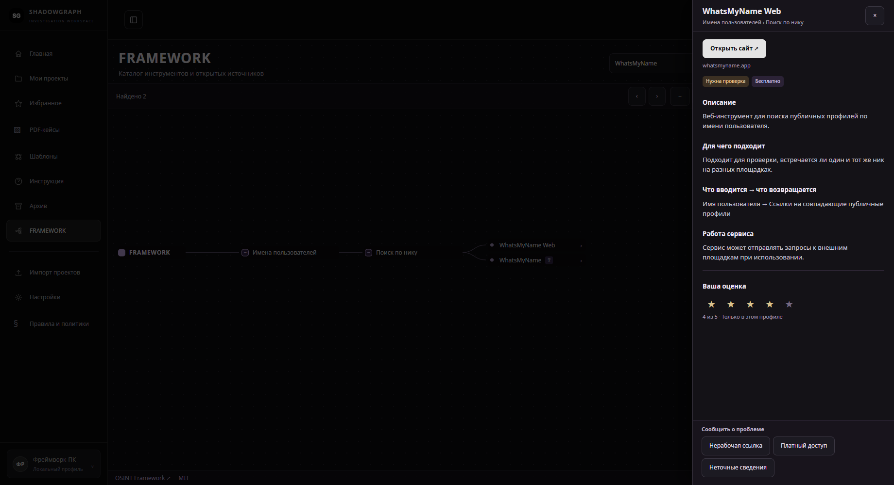

# SHADOWGRAPH

**Доска для исследований.** Собирайте файлы и заметки, проверяйте связи между объектами и оформляйте выводы в PDF. Материалы анализируются на устройстве, а проекты хранятся в браузере.

[Быстрый старт](#быстрый-старт) · [FRAMEWORK](#framework) · [Граф и отчёты](#граф-и-отчёты) · [Публикация](#публикация-на-github-pages) · [Поддержка](#поддержка)

## Быстрый старт

1. Создайте локальный профиль и сохраните выданный ключ доступа.
2. Создайте проект и выберите **Добавить материалы**. Включите анализ, чтобы приложение выделило объекты и предложило связи.
3. Откройте карточку находки, проверьте источник и при необходимости скорректируйте данные.
4. Выберите представление графа. Через **Экспорт** можно сохранить отчёт или резервную копию проекта.

| Учебный материал | Что с ним сделать |
| :--- | :--- |
| [Демонстрационный проект · JSON](docs/examples/demo-project.json) | Выберите **Импорт проектов** на главной, чтобы открыть готовый граф. |
| [Учебные заметки · TXT](docs/examples/demo-notes.txt) | Загрузите как материал и проверьте результаты анализа. |
| [Пример PDF-досье](docs/examples/sample-report.pdf) | Посмотрите, как оформлены источники и основания связей. |

Учебные материалы содержат вымышленные сведения. [Видеоинструкция для ПК](public/guide67/desktop.mp4) · [Видеоинструкция для телефона](public/guide67/phone.mp4).

## FRAMEWORK

Откройте **FRAMEWORK** в боковом меню под **Архивом**. На доске собрано **863 ресурса в 38 разделах**. Раскрывайте ветки или найдите нужный ресурс по названию и домену. Нажатие на ресурс показывает карточку с описанием и условиями доступа, когда эти сведения доступны. Для перехода на внешний сайт в карточке есть отдельная кнопка.

| Действие | Управление |
| :--- | :--- |
| Переместить доску | Перетащите её мышью или проведите одним пальцем. Стрелки на клавиатуре работают, когда доска в фокусе. |
| Изменить масштаб | Прокрутите колесо над доской, разведите два пальца или нажмите **−** / **+**. |
| Показать всё дерево | Нажмите **Вписать**. |
| Вернуться к началу | Нажмите кнопку с текущим процентом. |
| Сменить режим | Используйте **Список** или **Полный экран**. |

Карточка ресурса и проверка ссылок

Кнопка **Заметки** открывает расшифровку меток каталога и ссылку на отчёт. [Скачать отчёт по ссылкам · CSV](public/framework/link-audit.csv).

Каталог основан на [OSINT Framework](https://github.com/lockfale/OSINT-Framework). [Лицензия MIT](public/framework/LICENSE.txt).

## Граф и отчёты

Граф можно читать как карточки, плоскую схему, 3D-сеть, иерархию, хронологию или маршруты со стрелками. Используйте **Орбиты**, чтобы изучать связи вокруг выбранного объекта, и **Матрицу связей**, чтобы сравнивать объекты в таблице.

| Карточки | 3D-сеть |
| :---: | :---: |
|  |  |

- **Доска.** Добавляйте текст, рисуйте ручкой и размещайте точки на карте.
- **PDF-кейсы.** Откройте конструктор с главной, чтобы собрать отчёт из выбранных материалов и проверить его перед выгрузкой.
- **Резервные копии.** Сохраняйте важные проекты в JSON, чтобы перенести их в другой браузер.

[Посмотреть образец PDF](docs/examples/sample-report.pdf) · [История изменений](CHANGELOG.md).

## Публикация на GitHub Pages

1. Загрузите содержимое сборки в корень репозитория. Сохраните структуру папок `public/` и `docs/` и файл `.nojekyll`.
2. Откройте **Settings → Pages**. Выберите **Deploy from a branch**, укажите нужную ветку и папку **/ (root)**.
3. Дождитесь публикации и откройте адрес из раздела Pages. [Документация GitHub Pages](https://docs.github.com/en/pages/quickstart).

Для локального запуска откройте терминал в корне сборки, выполните `python -m http.server 8080` и откройте [localhost:8080](http://localhost:8080).

## Данные и приватность

Данные профиля и проекты привязаны к браузеру и адресу сайта. При смене адреса или устройства перенесите проекты через JSON. Ключ доступа храните отдельно. Онлайн-карта и ресурсы, которые вы открываете из каталога, работают через внешние сайты.

## Поддержка

[Telegram @auedurov](https://t.me/auedurov) · [shadowgraphsupport@duck.com](mailto:shadowgraphsupport@duck.com)
